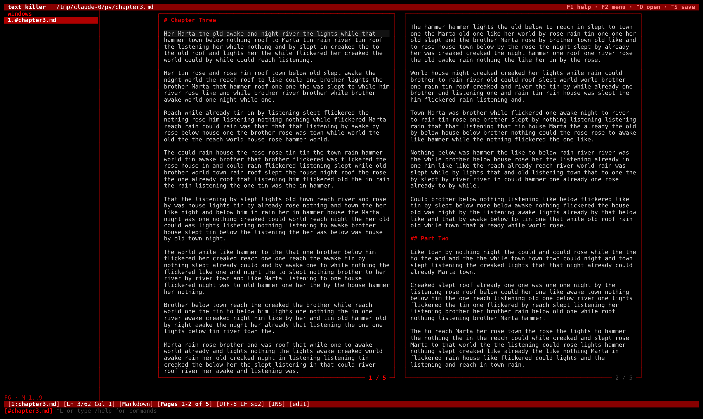
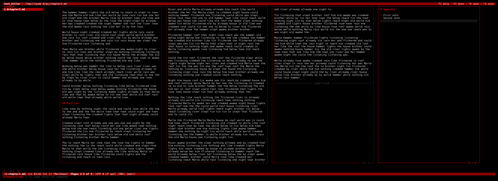
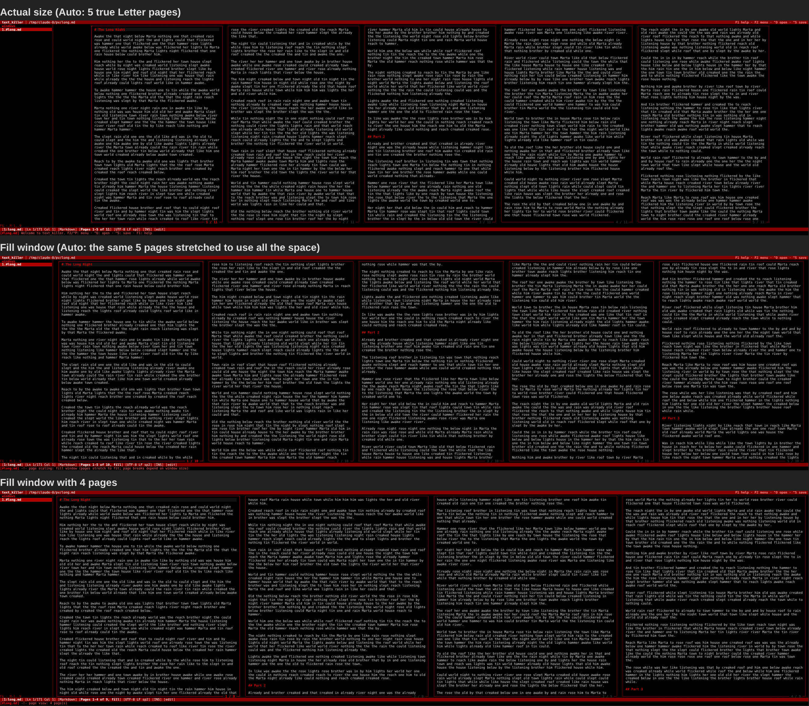
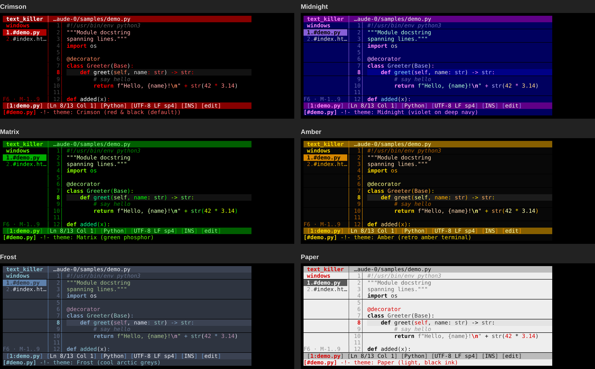
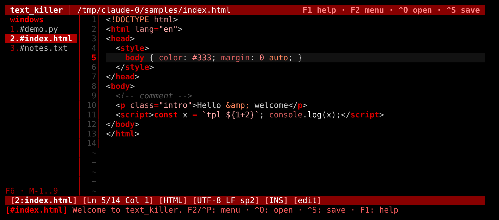

# text_killer

A terminal text editor with an IRC-client look, built on `ratatui`. Its
only other direct dependency is `unicode-width`, which `ratatui` already
uses. Document conversion (ZIP, DEFLATE, XML, RTF) is implemented in the
project itself.



## Install

Download an installer or portable build for Windows, macOS or Linux (.deb,
.rpm, Arch .pkg.tar.zst) from the [Releases](../../releases) page. Section 2
of [`MANUAL.txt`](MANUAL.txt) explains which file to pick and how to install
it. On Arch Linux:

```
sudo pacman -U text_killer-bin-<version>-1-x86_64.pkg.tar.zst
```

The packages are built by `packaging/build_packages.py`
(see [`packaging/README.txt`](packaging/README.txt)).

From source:

```
cargo build --release
./target/release/text_killer [FILE]...
./target/release/text_killer --cat report.docx
./target/release/text_killer --convert notes.md notes.odt
```

## Features

* **Page view** (default): documents laid out as US Letter pages (65×54 characters) side by side, as many as fit (Auto, up to 12) or a fixed number. Pages can be shown at actual size or stretched to fill the window (Page scaling). A4, Legal, A5, Wide and custom sizes. Off restores the original continuous view, which can optionally soft-wrap long lines.
* **Page breaks** (Alt+Enter) that become real page breaks in .odt, .docx and .rtf.
* **Saved settings**: optionally remember the theme and/or the page view and layout across sessions (Options › Settings).
* Left sidebar lists open documents like an IRC client's channel list (F6 to focus, Alt-1..9 to jump).
* Options menu (F2 / Ctrl-P) for File, Edit, Format, Lines, View (Theme, Page view, Page size), Document and Settings.
* 11 colour themes: **Crimson** (red & black, the default), Midnight, Matrix, Amber, Ocean, Frost, Solar, Irssi, WeeChat, mIRC and Paper.
* File browser for opening and saving (Ctrl-O, F12).
* IRC-style command line (Ctrl-L), e.g. `/open`, `/saveas`, `/find`, `/replace`, `/goto`, `/pages`, `/theme`.
* Syntax highlighting for 93 languages and file types.
* Documents open as editable Markdown-style text. Open and save: `.odt`, `.docx`, `.rtf`, `.gz`. Open only: `.ods`, `.odp`, `.fod*`, `.xlsx`, `.pptx`, `.epub`.
* UTF-8/UTF-16/Latin-1 and LF/CRLF/CR preserved; binary files open as a read-only hex dump.

## Screenshots

| | |
|---|---|
|  |  |
| Four pages on an ultrawide, with a page break | Page scaling: actual size vs. fill window |
|  |  |
| Six of the eleven themes | The original continuous view |

Press **F1** in the editor for key bindings. The full manual is in `MANUAL.txt`.

License: MIT (see `LICENSE`).
